# Continuous Deployment Project Documentation

# Project Overview

* The goal of this project was to build a Continuous Deployment pipeline that automatically deploys updated Docker containers to an AWS EC2 instance.
* GitHub Actions builds a Docker image and pushes it to Docker Hub.
* GitHub Webhooks send a payload when the workflow completes.
* A webhook listener on the EC2 instance receives the payload.
* The webhook listener executes a deployment script.
* The deployment script pulls the newest image and refreshes the running container.

## Deployment Diagram

```mermaid
flowchart LR

A[Code Push] --> B[GitHub Repository]

B --> C[GitHub Actions]

C --> D[Build Docker Image]

D --> E[Push Image to Docker Hub]

E --> F[workflow_run.completed]

F --> G[GitHub Webhook]

G --> H[EC2 Webhook Listener]

H --> I[refresh.sh]

I --> J[Stop Old Container]

J --> K[Remove Old Container]

K --> L[Pull Latest Image]

L --> M[Run New Container]

M --> N[Updated Website]
```



* All major components are currently functioning.
* GitHub Actions successfully builds images.
* Docker Hub stores the latest image.
* GitHub webhooks successfully deliver payloads.
* The deployment script refreshes the running container automatically.

# Part 1

* EC2 Instance
  * An EC2 instance is the virtual machine used to host the deployment server.
  * Operating System: Ubuntu Server 24.04 LTS
  * Instance Type: t2.micro
  * Elastic IP: 100.55.188.60


* Security Group
  * Security groups act as the firewall for the EC2 instance.
  * Port 22 is used for SSH.
  * Port 80 is used for HTTP website traffic.
  * Port 9000 is used for webhook traffic.

* Docker Installation
  * Docker was installed using:
    ```bash
    sudo apt update
    sudo apt install docker.io -y
    ```
  * Docker was enabled using:
    ```bash
    sudo systemctl enable docker
    sudo systemctl start docker
    ```
  * Docker access was granted to the ubuntu user.


* Docker Image
  * Docker Hub repository:
    ```text
    roguememer/ceg3120-cicd-stein55-f26
    ```
  * The image is pulled from Docker Hub before deployment.
  * The container serves the web application on port 80.

* Refresh Script
  * File:
    ```text
    deployment/refresh.sh
    ```
  * The script:
    * Stops the old container.
    * Removes the old container.
    * Pulls the newest image.
    * Starts a new container.
    * Uses automatic restart behavior.


# Part 2

* Webhook Listener
  * Installed using:
    ```bash
    sudo apt install webhook -y
    ```
  * Verified with:
    ```bash
    webhook -version
    ```
  * The webhook listener waits for payloads on port 9000.

* Hook Definition
  * File:
    ```text
    deployment/hooks.json
    ```
  * The hook is called:
    ```text
    docker-refresh
    ```
  * The hook executes:
    ```text
    deployment/refresh.sh
    ```
  * Requests are verified using:
    ```text
    X-Hub-Signature-256
    ```


* Webhook Service
  * File:
    ```text
    deployment/webhook.service
    ```
  * The service automatically starts webhook when the instance boots.
  * Enabled using:
    ```bash
    sudo systemctl enable webhook
    ```
  * Started using:
    ```bash
    sudo systemctl start webhook
    ```


* Negative Test
  * A test request was sent using:
    ```bash
    curl -X POST http://100.55.188.60:9000/hooks/docker-refresh
    ```
  * The response was:
    ```text
    Hook rules were not satisfied.
    ```


# Part 3

* GitHub Webhook
  * Payload URL:
    ```text
    http://100.55.188.60:9000/hooks/docker-refresh
    ```
  * Content Type:
    ```text
    application/json
    ```
  * The same secret was used in both GitHub and hooks.json.

* Selected Event
  * Selected Event:
    ```text
    workflow_run
    ```
  * Trigger:
    ```text
    workflow_run.completed
    ```

* Why I Chose This Event
  * I selected workflow_run.completed because it happens after GitHub Actions finishes building and pushing the image to Docker Hub.
  * I did not choose push because a push event happens before the image is finished building.
  * This guarantees that the latest image already exists when the deployment script runs.

* Payload Delivery
  * GitHub delivered the payload successfully.
  * Response:
    ```text
    200 OK
    ```

* GitHub Webhooks vs Docker Hub Webhooks
  * GitHub Webhooks trigger from repository events.
  * Docker Hub Webhooks trigger from image repository events.
  * GitHub Webhooks support validation using X-Hub-Signature-256.
  * I would choose GitHub Webhooks because they tie directly into the GitHub Actions workflow and allow signature validation before deployment occurs.

# Part 4

* End to End Deployment
  * A code change is pushed to GitHub.
  * GitHub Actions builds a Docker image.
  * Docker Hub stores the image.
  * GitHub sends a webhook payload.
  * The EC2 webhook listener receives the payload.
  * refresh.sh executes automatically.
  * The old container is removed.
  * The newest image is pulled.
  * A new container is started.
  * The website updates automatically.

* This screenshot proves the website is running from the Docker container.
  * 

* This screenshot proves a new container was created after deployment.
  * 

# Sources

* GitHub Documentation
  * https://docs.github.com/en/webhooks
  * Used for GitHub webhook setup.

* GitHub Webhook Validation
  * https://docs.github.com/en/webhooks/using-webhooks/validating-webhook-deliveries
  * Used for signature verification research.

* Docker Documentation
  * https://docs.docker.com
  * Used for deployment and container management research.

* webhook
  * https://github.com/adnanh/webhook
  * Used for webhook listener configuration.

* AI Usage
  * Microsoft Copilot
  * Used for:
    * README formatting
    * Bash script troubleshooting
    * Webhook troubleshooting
    * Docker deployment troubleshooting

  * Example prompts:
    * "could this README get a high grade?"
    * "what screenshots should i take"
    * "help me configure webhook"
    * "why is GitHub webhook failing"
    * "create a deployment diagram"

    *Repository i used: https://github.com/RogueMemer/ceg3120-cicd-stein55-f26
